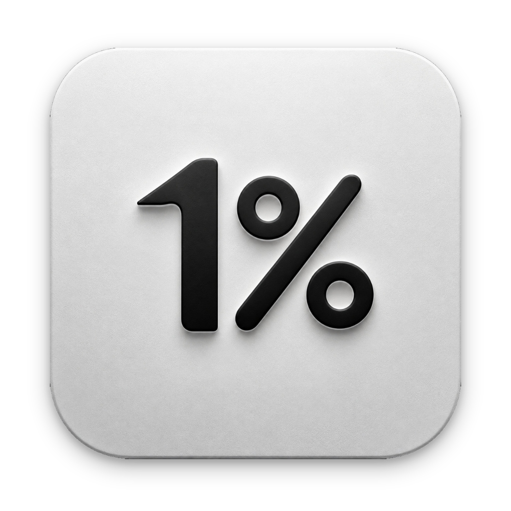
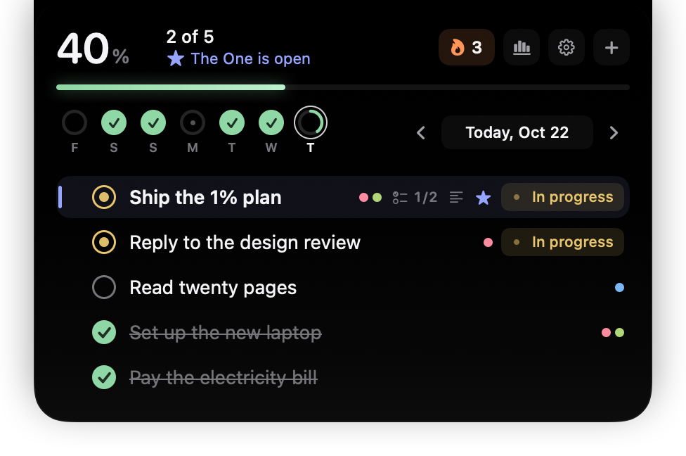
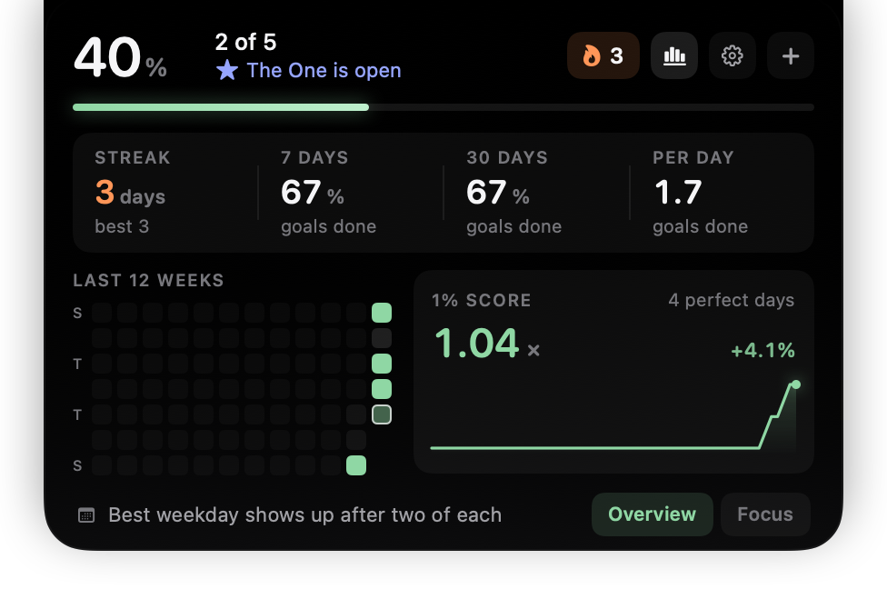
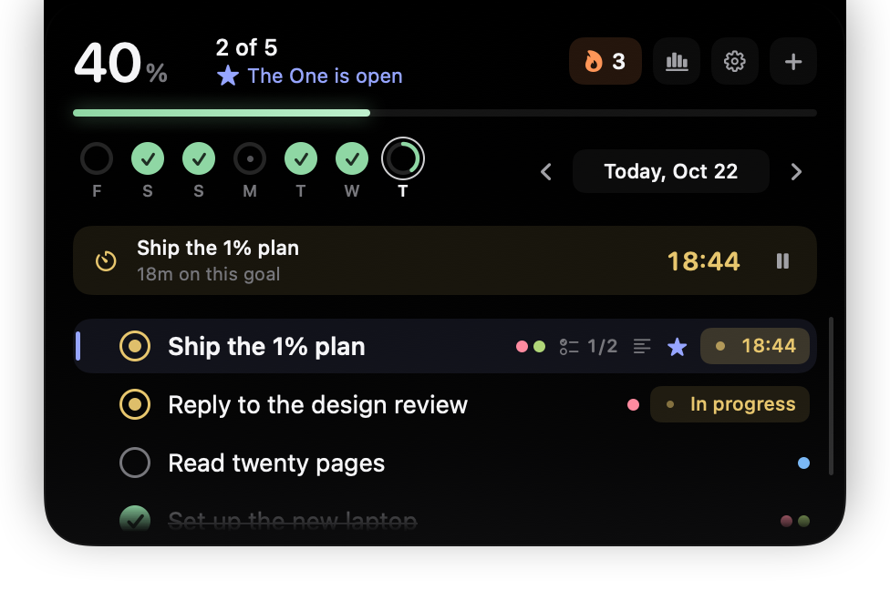
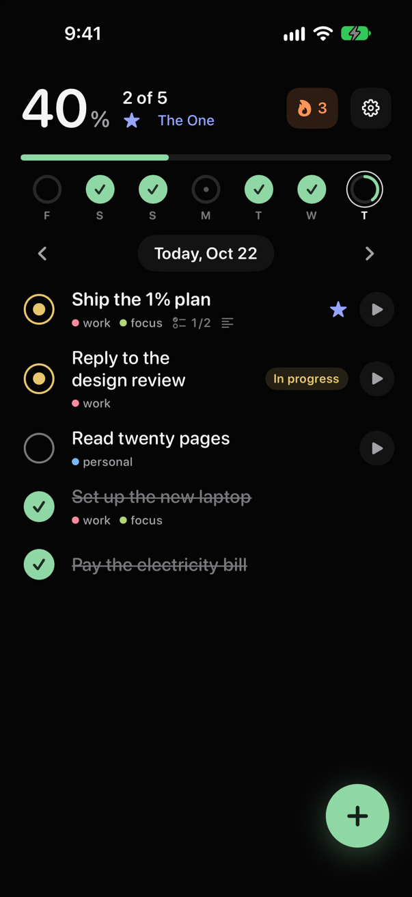
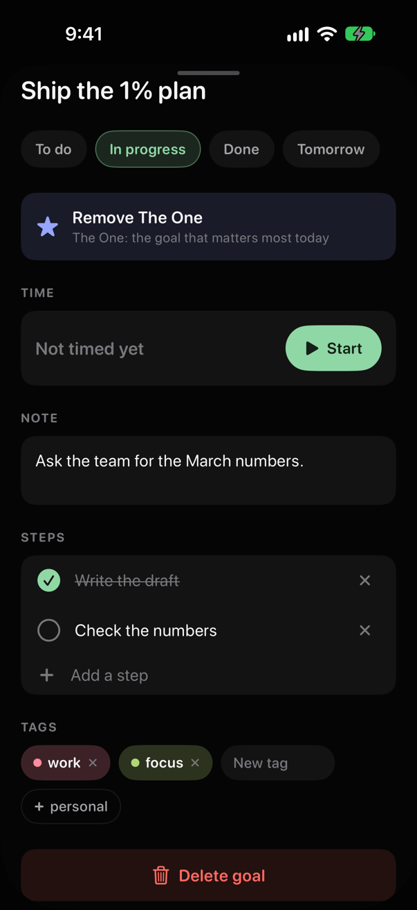
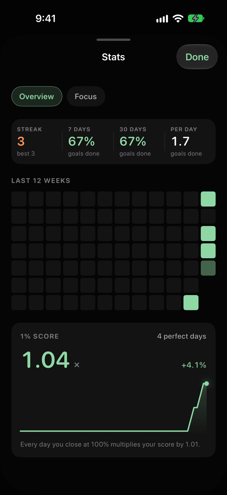
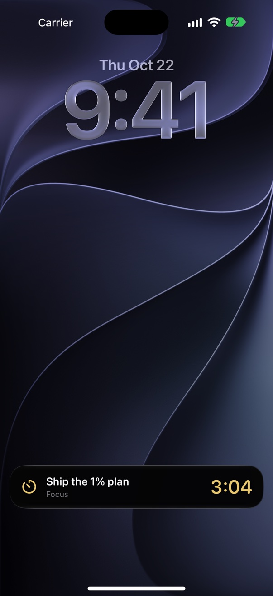

<div align="center">



# One Percent

**Migliora dell'1% ogni giorno.**

Un piccolo tracker di obiettivi giornalieri che vive nel notch del MacBook, con un'app per iPhone.

[](https://github.com/emanueleR3/One-Percent/actions/workflows/ci.yml)


[](LICENSE)

[**Scarica per Mac**](https://github.com/emanueleR3/One-Percent/releases/latest) · [Compila dal codice](#compila-dal-codice) · [Read in English](README.md)



</div>

---

Porta il puntatore sul notch e la tua giornata scende giù: gli obiettivi di oggi, a che punto sei e
l'unica cosa che conta davvero. Segna qualcosa come fatto, avvia un timer, sposta il resto a domani,
allontanati e sparisce. Nessuna icona nel Dock, nessuna finestra da gestire.

L'app per iPhone mostra la stessa giornata, con widget e Live Activity. Le due restano sincronizzate
tramite un tuo progetto Supabase gratuito, oppure non si sincronizzano affatto: ognuna funziona
benissimo da sola.

Swift e SwiftUI nativi, nessuna dipendenza esterna, nessuna analytics.

## Indice

- [Funzionalità](#funzionalità)
- [Screenshot](#screenshot)
- [Installazione](#installazione)
- [Compila dal codice](#compila-dal-codice)
- [Sincronizzazione cloud (facoltativa)](#sincronizzazione-cloud-facoltativa)
- [Test](#test)
- [Struttura del progetto](#struttura-del-progetto)
- [Come funziona](#come-funziona)
- [Privacy](#privacy)
- [Limiti noti](#limiti-noti)
- [Contribuire](#contribuire)
- [Licenza](#licenza)

## Funzionalità

### Sul Mac

- **Vive nel notch.** Passa sopra il notch e il pannello si apre; allontanati e si chiude. Funziona
  sopra le app a schermo intero e in ogni Spazio. Sui Mac senza notch fa lo stesso una striscia in
  cima allo schermo (a sinistra, al centro o a destra).
- **Notch virtuale.** Un notch nero facoltativo, un po' più largo di quello vero, che sui lati mostra
  l'anello dei progressi di oggi e `fatti/totale`, oppure il timer in corso.
- **Obiettivi con quattro stati:** da fare, in corso, fatto, domani. Clic per completare, doppio clic
  per rinominare, trascina per riordinare, clic destro per tutto il resto. Quelli fatti scendono in
  fondo da soli.
- **The One.** Metti la stella all'obiettivo più importante di oggi e resta in cima.
- **Abitudini.** Ripeti un obiettivo ogni giorno, nei giorni feriali o nei giorni che scegli, ognuno
  con la sua serie.
- **Tag, passaggi e note.** Scrivi i `#tag` direttamente nel titolo; aggiungi una checklist e una nota
  nella pagina dell'obiettivo.
- **Aggiunta intelligente** (macOS 26 con Apple Intelligence). Scrivi *"chiamare la mamma domani
  #famiglia"* e il modello sul dispositivo sceglie il giorno, la ripetizione e i tag che usi già.
  Niente esce dal Mac.
- **Timer di concentrazione e Pomodoro.** Un cronometro per ogni obiettivo, oppure blocchi di
  concentrazione con pause brevi e lunghe. Si ferma quando il Mac va in stop.
- **Chiusura serale.** Dopo le 21:00 (l'orario lo scegli tu) propone di spostare a domani quello che
  resta, con annulla.
- **Promemoria discreti.** Piano del mattino, controllo del pomeriggio e chiusura serale, tutti
  facoltativi. Arrivano solo quando c'è qualcosa di utile da dire.
- **Statistiche.** Serie, completamento a 7 e 30 giorni, una heatmap di 12 settimane, il tuo giorno
  migliore, il tempo di concentrazione per obiettivo e il **punteggio 1%**: 1,01 elevato al numero di
  giornate perfette.
- **Italiano e inglese**, si cambia lingua senza riavviare. Avvio al login.

### Su iPhone

- **Schermata Oggi** con gli stessi obiettivi: scorri per Domani, Elimina o The One, tieni premuto per
  il resto, compreso il riordino.
- **Widget** per la schermata Home (piccolo, medio) e per la schermata di blocco (circolare,
  rettangolare). I titoli degli obiettivi sono nascosti finché il telefono è bloccato.
- **Live Activity e Dynamic Island** per il timer o il blocco Pomodoro in corso, anche se l'hai avviato
  sul Mac.
- Pagine degli obiettivi, abitudini, statistiche, statistiche di concentrazione, Pomodoro e
  promemoria, come sul Mac.
- **Controllo della firma.** Installata con un Apple ID gratuito, l'app sa quando scade la sua firma
  di 7 giorni e ti avvisa la sera prima.

### Tra i due

Obiettivi e abitudini si sincronizzano tramite un progetto Supabase tuo. Le modifiche arrivano in un
paio di secondi, ogni dispositivo tiene una copia locale completa e le due app funzionano anche
offline. Le impostazioni restano su ciascun dispositivo. Vedi
[Sincronizzazione cloud](#sincronizzazione-cloud-facoltativa).

## Screenshot

Tutti gli screenshot usano gli obiettivi di esempio della [modalità demo](#3-app-iphone).

<table>
  <tr>
    <td width="50%"></td>
    <td width="50%"></td>
  </tr>
  <tr>
    <td align="center"><sub>Statistiche e punteggio 1%</sub></td>
    <td align="center"><sub>Timer di concentrazione</sub></td>
  </tr>
</table>

<table>
  <tr>
    <td width="25%"></td>
    <td width="25%"></td>
    <td width="25%"></td>
    <td width="25%"></td>
  </tr>
  <tr>
    <td align="center"><sub>Oggi</sub></td>
    <td align="center"><sub>Pagina obiettivo</sub></td>
    <td align="center"><sub>Statistiche</sub></td>
    <td align="center"><sub>Live Activity</sub></td>
  </tr>
</table>

## Installazione

### Mac

La versione scaricabile funziona sui Mac con Apple silicon e macOS 14 o successivo. Su un Mac
Intel, [compila dal codice](#compila-dal-codice).

1. Scarica `One-Percent-v<versione>.dmg` dall'[ultima release](https://github.com/emanueleR3/One-Percent/releases/latest),
   aprilo e trascina **One Percent** in **Applicazioni**.
2. L'app è firmata ad hoc e non è notarizzata da Apple, quindi la prima volta macOS la blocca. Apri
   **Impostazioni di Sistema → Privacy e sicurezza**, scorri in basso e clicca **Apri comunque**.
   Oppure, nel Terminale:
   ```bash
   xattr -dr com.apple.quarantine "/Applications/One Percent.app"
   ```
3. Cerca l'icona **%** nella barra dei menu, poi porta il puntatore sul notch.

La versione scaricabile ha la sincronizzazione cloud spenta, perché serve un tuo progetto Supabase.
[Compila dal codice](#compila-dal-codice) per attivarla.

### iPhone

L'app per iPhone non è sull'App Store. Compilala dal codice e installala con un Apple ID gratuito,
come spiegato qui sotto.

## Compila dal codice

### Requisiti

- macOS 14 o successivo e **Xcode 26.6 o successivo** (sviluppato con Xcode 27; la CI compila con
  26.6). L'aggiunta intelligente usa il modello sul dispositivo dell'SDK di macOS 26; con un SDK più
  vecchio l'app si compila lo stesso, senza quella funzione.
- Per l'iPhone: iOS 17 o successivo, un Apple ID collegato a Xcode (va bene anche gratuito) e la
  Modalità sviluppatore attiva.
- Python 3, incluso negli strumenti da riga di comando di Xcode, per gli script.

### 1. Clona e configura

```bash
git clone https://github.com/emanueleR3/One-Percent.git
cd One-Percent
cp Config/Local.example.xcconfig Config/Local.xcconfig
```

Compila `Config/Local.xcconfig` (git lo ignora). Ogni valore è facoltativo: senza, l'app Mac e la
build per il Simulatore iPhone funzionano così come sono, con la sincronizzazione spenta.

| Impostazione | Cos'è | Serve per |
| --- | --- | --- |
| `ONEPERCENT_TEAM_ID` | Il tuo Team ID Apple. Va bene un Personal Team gratuito. | Installare su iPhone |
| `ONEPERCENT_BUNDLE_ID` | Il bundle ID dell'app iPhone, unico per te, es. `com.tuonome.onepercent` | Installare su iPhone |
| `ONEPERCENT_SUPABASE_HOST` | L'host del tuo progetto Supabase, **senza** `https://` | Sincronizzazione cloud |
| `ONEPERCENT_SUPABASE_KEY` | La chiave publishable del progetto | Sincronizzazione cloud |

Per trovare il Team ID, con Xcode collegato al tuo Apple ID:

```bash
security find-certificate -c "Apple Development" -p | openssl x509 -noout -subject
```

È il valore `OU=` di 10 caratteri.

> [!TIP]
> Imposta il team in `Local.xcconfig`, non nella scheda *Signing & Capabilities* di Xcode: Xcode lo
> scriverebbe nel file di progetto condiviso.

### 2. App Mac

```bash
swift run OnePercent           # avvio veloce dal terminale
zsh Scripts/build-app.sh       # crea build/One Percent.app
zsh Scripts/make-dmg.sh        # crea build/One-Percent-v<versione>.dmg
```

`swift run` avvia un eseguibile semplice: il pannello funziona, ma promemoria, avvio al login e
sincronizzazione richiedono il bundle `.app`. Copia `build/One Percent.app` in `/Applications` per
usarla tutti i giorni. Puoi anche aprire `Package.swift` in Xcode.

### 3. App iPhone

**Simulatore:** apri `iOS/OnePercentiOS.xcodeproj`, scegli lo schema `OnePercentiOS` e un simulatore,
e premi Run. Non serve un account Apple. Su un simulatore appena avviato, il primo avvio può restare
nero per 10–20 secondi.

**Il tuo iPhone:** collegalo, sbloccalo e lancia:

```bash
zsh Scripts/install-iphone.sh
```

Compila l'app, la firma con il tuo team, la installa e la apre. La prima volta iOS ti chiede di
fidarti dello sviluppatore: **Impostazioni → Generali → VPN e gestione dispositivi**.

Un Apple ID gratuito firma le app per 7 giorni. Per far rinnovare la firma al Mac da solo:

```bash
zsh Scripts/iphone-autorefresh.sh install   # anche: status, run, remove
```

Un piccolo processo in background controlla ogni ora e reinstalla l'app passati 6 giorni, via Wi-Fi
se il telefono non è collegato. Per questo attiva una volta **Connect via network** in Xcode, in
**Window → Devices and Simulators**.

**Modalità demo.** Le build di debug avviate con `-demo` (Xcode: *Product → Scheme → Edit Scheme →
Run → Arguments*) mostrano obiettivi di esempio che non vengono mai salvati né sincronizzati.
Aggiungi `-demoItalian` per i dati in italiano, `-demoSheet add|settings|stats|detail` per aprire una
schermata o `-demoFocus` per avviare un timer.

Il progetto Xcode è generato da `Scripts/generate-ios-project.py`. Le cartelle dei sorgenti sono
sincronizzate, quindi aggiungere un file Swift non richiede modifiche al progetto; tocca lo script
solo per cambi di struttura.

## Sincronizzazione cloud (facoltativa)

1. Crea un progetto gratuito su [supabase.com](https://supabase.com) e metti host e chiave publishable
   in `Config/Local.xcconfig`.
2. Esegui [`supabase/migrations/20261009000000_sync_records.sql`](supabase/migrations/20261009000000_sync_records.sql)
   nel SQL editor del progetto.
3. Crea il tuo utente (*Authentication → Users → Add user*), poi disattiva le nuove registrazioni.
4. Ricompila le due app e accedi dalle Impostazioni su ogni dispositivo.

Le app fanno solo l'accesso e non hanno una schermata di registrazione, quindi con le registrazioni
disattivate nessun altro può usare il tuo progetto. La guida completa, il formato dei dati e le
verifiche sono in [`supabase/README.md`](supabase/README.md) (in inglese).

## Test

```bash
swift test                         # 360+ test unitari: logica, motore di sync, logica del pannello Mac
zsh supabase/tests/run-local.sh    # test dello schema su un Postgres usa e getta (serve Docker)
zsh Scripts/test-live.sh           # sync end-to-end sul tuo progetto Supabase
```

GitHub Actions esegue i test unitari, una build dell'app iPhone per il Simulatore e i test dello
schema a ogni push e pull request.

## Struttura del progetto

```text
.
├── Package.swift            Pacchetto Swift: l'app Mac, il core condiviso e i test
├── Sources/
│   ├── OnePercentCore/      Condiviso dalle due app: modelli, store, statistiche, timer, sync, lingue
│   └── OnePercent/          L'app Mac: finestra del notch, pannello, barra dei menu, promemoria
├── iOS/
│   ├── OnePercentiOS/       L'app iPhone (SwiftUI)
│   ├── OnePercentWidget/    Widget e Live Activity
│   ├── Shared/              Codice comune ad app e widget
│   ├── Config/              Info.plist ed entitlements
│   └── OnePercentiOS.xcodeproj   Generato da Scripts/generate-ios-project.py
├── Config/                  Team ID, bundle ID, progetto Supabase (i tuoi valori: Local.xcconfig)
├── Resources/               Info.plist del Mac, icona, pacchetti lingua, sfondo del DMG
├── Scripts/                 Build, pacchetto, installazione, traduzioni e lettura della config
├── supabase/                Backend di sync: migrazione, test dello schema, guida
├── Tests/                   Test unitari (XCTest)
└── docs/images/             Screenshot
```

## Come funziona

- **Un core, due app.** `OnePercentCore` contiene tutto ciò che non ha interfaccia: modelli di
  obiettivi e abitudini, lo store e le sue operazioni, le regole per rimandare, le statistiche, il
  timer e il motore Pomodoro, la pianificazione dei promemoria, le lingue e il motore di sync. L'app
  Mac (AppKit e SwiftUI) e l'app iPhone (SwiftUI) sono strati sottili sopra.
- **Prima di tutto in locale.** Ogni dispositivo tiene i dati in JSON in Application Support
  (`~/Library/Application Support/OnePercent/` sul Mac): `tasks.json`, una copia del salvataggio
  precedente e `habits.json`. Un file illeggibile viene messo da parte, mai sovrascritto.
- **Sync.** Una tabella Postgres conserva ogni obiettivo e abitudine come documento JSON, e la row-level
  security limita ogni account alle sue righe. Le app inviano e ricevono via REST e ascoltano un
  WebSocket Realtime, tutto con `URLSession`. Vince l'ultima modifica a ogni elemento, e le
  cancellazioni viaggiano come tombstone.
- **Le abitudini** creano i loro obiettivi giornalieri con ID deterministici, così Mac e iPhone creano
  lo stesso obiettivo per lo stesso giorno invece di due.
- **I timer** sono salvati come orari di inizio, non contatori, quindi continuano a contare ad app
  chiusa e sopravvivono ai riavvii.

## Privacy

Senza un progetto Supabase le app non fanno nessuna richiesta di rete. Con un progetto, i tuoi
obiettivi vanno solo lì. Nessun account oltre al tuo, nessuna analytics, nessun tracciamento.
L'aggiunta intelligente gira sul dispositivo.

## Limiti noti

- L'app Mac non è notarizzata, quindi macOS avvisa prima del primo avvio.
- L'app iPhone non è sull'App Store; con un Apple ID gratuito la firma dura 7 giorni (ci pensa il
  rinnovo automatico descritto sopra).
- Impostazioni, colori dei tag e orari dei promemoria restano su ciascun dispositivo; si
  sincronizzano solo obiettivi e abitudini.
- L'aggiunta intelligente c'è solo sul Mac.
- L'interfaccia è in italiano e inglese.

## Contribuire

Segnalazioni, idee e pull request sono benvenute. Leggi prima [CONTRIBUTING.md](CONTRIBUTING.md) (in
inglese) e segnala i problemi di sicurezza in privato come spiegato in [SECURITY.md](SECURITY.md).
Le modifiche sono elencate in [CHANGELOG.md](CHANGELOG.md).

## Licenza

[MIT](LICENSE) © 2026 Emanuele Romano
